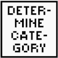
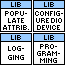

# Silly-Billy

Syllable-aware text icons for LabVIEW using Quick-Drop's **Set Text Icon** action (<kbd>Ctrl</kbd>+<kbd>K</kbd>).

## How it works

The package replaces `vi.lib\LabVIEW Icon API\Set Text Icon\Adjust Text to Fit Rectangle.vi` —
the VI that LabVIEW's built-in *Set Text Icon* Quick-Drop plugin calls when it lays text into the
icon. Everything else about the workflow stays the same: press <kbd>Ctrl</kbd>+<kbd>K</kbd> in
Quick-Drop and the icon text is generated from the file name, but now line breaks fall on
syllables produced by [hyphen library](https://github.com/hunspell/hyphen) with the
US English dictionary (`hyph_en_US.dic`).

- Words are only broken at valid hyphenation points
- Words containing `-` or `--` are split there
- Exception map for known abbreviations

## Requirements

- LabVIEW 2020 64bit or later
- Windows only

## Installation

Install the `Silly Billy` package with the VI Package Manager.
Uninstalling restores NI's original `Adjust Text to Fit Rectangle.vi`.

## License

The code in this repository is released under the MIT license (see [LICENSE](LICENSE)).

This project uses [hyphen](https://github.com/hunspell/hyphen) for syllable separation.
hyphen is tri-licensed under GPL-2.0-or-later / LGPL-2.1-or-later / MPL-1.1; it is used here
under the terms of LGPL-2.1 or MPL-1.1 and shipped as a separate shared library
(`hyphen.dll`). Both license texts are included in
`source/vi.lib/Silly Billy/thirdparty/licenses`.
